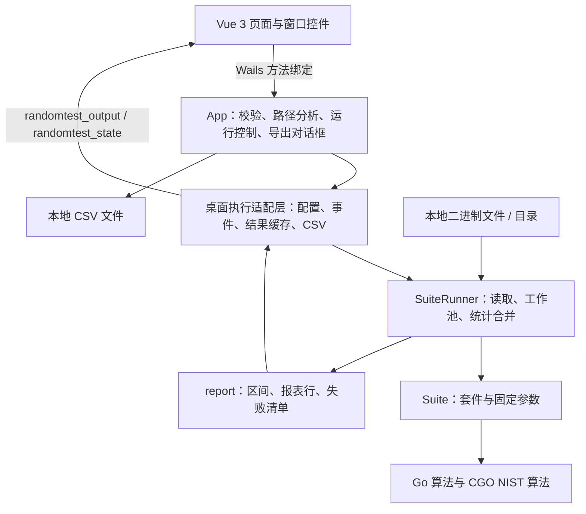
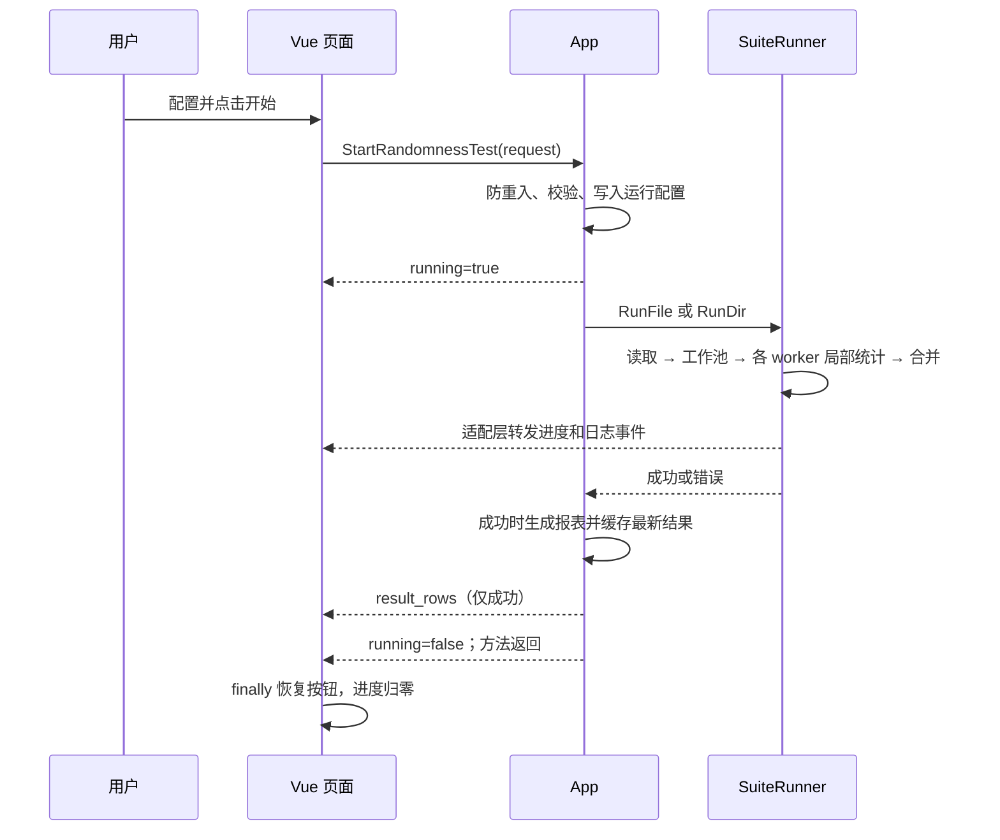

# 随机数检测工具程序设计说明书

文档版本：1.0　编制日期：2026-10-09　适用基线：[文档索引](00_文档索引.md)。

## 1. 设计范围与功能

本程序是基于 Vue 3、Wails v2 和 Go 的 Windows 桌面随机性检测工具。用户配置阈值、检测套件和输入路径后，程序读取本地二进制数据，执行多项随机性测试，将跨样本统计结果、进度和日志呈现于桌面窗口，并支持 CSV 导出。

已实现功能：NIST 2 级与 GM 1/2/3 级套件选择、目录选择与路径输入、输入样本分析、并发检测、协作式停止、结果表、运行日志、CSV 导出、主题切换和独立进程的新窗口。

界面中的“等级”是本程序的样本规模与参数配置标识。NIST 的“2 级”不应解释为 NIST SP 800-22 本身定义的等级制度。当前实现也没有把统计检测结果提升为生成器安全认证。

## 2. 总体架构



检测工作在本地执行。桌面模块通过 Wails 方法绑定与事件通信，不依赖仓库中另一个 `randomtest_web_gin` HTTP 服务。前端资源编译后通过 Go `embed.FS` 嵌入 exe；运行正式版本不需要启动 Vite 或随 exe 分发源码、`node_modules`、`frontend/dist`。

Windows 窗口由 Wails 托管，页面由 WebView2 Runtime 渲染。程序不内置完整的 WebView2 Runtime，目标机器必须具备运行库；相关分发要求见 [Microsoft 文档](https://learn.microsoft.com/en-us/microsoft-edge/webview2/concepts/distribution)。

### 2.1 模块职责

| 文件或模块 | 职责 |
|---|---|
| `main.go` | 嵌入前端、解析 `-x/-y`、设置窗口和生命周期、绑定 App |
| `app.go` | 前后端请求/返回结构、路径分析、阈值与参数校验、任务启停、原生目录对话框、新窗口 |
| `randomtest_stdtest_vue3_wailsv2.go` | INI 初始化、套件选择、调用运行器、事件批处理、目录明细、最新结果缓存及 CSV 编码 |
| `frontend/src/App.vue` | 标题栏、最大化/最小化/关闭、更多菜单、主题及关于面板 |
| `frontend/src/components/RandomtestMain.vue` | 参数表单、样本元信息、结果表、进度、日志及 Go 方法调用 |
| `frontend/src/components/About.vue` | 应用信息和 `v1.0.1` 界面版本文字 |
| `frontend/src/wailsjs/` | 自动生成的方法绑定、数据模型和运行时接口；当前组件使用这一目录 |
| `randomtest_core/suite.go` | 四套实际检测清单、块大小、参数与结果归一化 |
| `randomtest_core/runner.go` | 文件/目录输入、工作池、局部统计、进度和取消 |
| `randomtest_core/report/report.go` | 通过数区间、结果行、文件级判定与日志表 |
| `randomtest_core/func_nist.go` | 部分 NIST 算法的 CGO 调用、模板缓存、C 内存与错误转换 |

### 2.2 窗口和存储

初始及最小窗口尺寸为 1000 × 714，允许调整尺寸，无系统边框，使用自绘标题栏。Windows 配置开启透明 WebView、半透明窗口和 Mica 背景；本机已验证 Windows 11 下启动，未据此声明其他平台的相同视觉效果。

无 `-x/-y` 时启动后居中；两个位置参数均有效时，在约 200 ms 后设置窗口坐标并显示。更多菜单的“新建窗口”使用 `os.Executable()` 启动独立进程，位置按当前窗口右侧计算；它不是同进程的多窗口。各进程的任务与结果缓存相互独立，默认 WebView2 数据目录可能共用。

当前源码未设置 `WebviewUserDataPath`。Wails/当前 go-webview2 加载器使用 `%APPDATA%\<可执行文件名>` 作为浏览器数据目录。主题保存在 WebView2 的 localStorage，键名 `app-theme`。任务参数、日志和结果没有自动写回 INI 或恢复会话的机制。

## 3. 输入与配置设计

### 3.1 支持的套件

| 套件 | 样本位数 | 每样本字节数 | Suite 检测项数 |
|---|---:|---:|---:|
| NIST 2 级 | 1,000,000 | 125,000 | 17 |
| GM 1 级 | 20,000 | 2,500 | 20 |
| GM 2 级 | 1,000,000 | 125,000 | 25 |
| GM 3 级 | 100,000,000 | 12,500,000 | 27 |

Suite 项数不等于最终结果表行数；NIST 多值项会展开。完整清单与参数见 [测试项附录](03_测试项与参数附录.md)。套件按代码命名引用 NIST SP 800-22 和 GM/T 0005-2021，覆盖及判定应按当前实现审查。

输入是原始 bytes，每字节按从高位到低位展开成 8 bits。程序不会将 `0101` 文本、十六进制文本或 CSV 自动解析为对应的位序列，也不根据扩展名识别数据编码。

### 3.2 两种输入模式

**目录模式：**只扫描目录第一层；忽略子目录；文件大小必须与套件的字节块大小完全一致。大小不符时记录警告并跳过。每个合格文件是一个样本，全部合格文件均参与检测，实际数量作为统计分母。没有合格文件时返回错误。路径分析阶段与正式运行阶段分别扫描，二者之间文件变化可能使数量不同。

**文件模式：**按块从文件开头依次读取 `TestNum` 个完整块。路径分析返回 `floor(文件大小/块大小)`；若使用该分析结果，末尾不足一个块的数据不参与检测。直接调用执行入口时，块数超过实际数据会返回读取不足错误，少于实际块数时只检测前面的指定块数。

界面“选择目录”只打开目录对话框；后端同时支持文件模式。手工输入文件路径后，必须触发路径分析，使样本数量与文件完整块数量同步。文件类型由 `os.Stat` 判定，路径不存在时扩展名只是后备推断，实际读取仍会失败。

### 3.3 INI 与默认值

程序初始化时可选读取工作目录下的 `./randomtest_stdtest_vue3_wailsv2_config.ini`，不是固定从 exe 所在目录读取。INI 未找到或加载失败时，启动初始化不因该错误退出，运行配置可能保留零值。`GetTestFormDefaults` 会将未识别标准返回为“未知”；Vue 选择器可能显示空白，用户须重新选择标准。

```ini
[config]
IsFile = false
FilePath = "C:\RandomTestData\all_samples.bin"
TestNum = 1000
RootDirPath = "C:\RandomTestData\samples"
TestType = N
TestLevel = 2
workers = 4
```

| 配置项 | 使用方式 |
|---|---|
| `IsFile` | 初始输入模式；界面路径分析/启动时按实际路径重新确定 |
| `FilePath` / `RootDirPath` | 相应模式的初始路径；加载后清理首尾残留引号 |
| `TestNum` | 文件模式指定块数；目录模式以扫描实际数量为准 |
| `TestType` | 初始标准建议严格写 `N` 或 `G` |
| `TestLevel` | NIST 为 2；GM 为 1/2/3 |
| `workers` | 单独以小写键查找；正整数生效，否则采用 `runtime.NumCPU()` |

配置键存在大小写差异：结构字段按字段名映射，而并发数额外调用 `GetKey("workers")`。仓库示例中的 `Workers = 0` 仍会落入自动 CPU 核数行为；若需明确控制并发数，应使用小写 `workers`。

P/Q 阈值来自 core 的内存默认值 `0.01/0.0001`，这两个值不由上述 INI 字段设置。界面修改不会保存到 INI。

## 4. 前后端接口

| 方法 | 输入与返回 | 说明 |
|---|---|---|
| `GetTestFormDefaults()` | 返回阈值、标准、等级、路径、模式和样本提示 | 从当前内存配置生成 |
| `PickInputPath()` | 返回 `{path,isFile}` 或错误 | 目录对话框；成功时 `isFile=false` |
| `AnalyzeInputPath(req)` | 返回样本 bits、数量、最小通过量和模式 | 按标准、等级、路径和 P 阈值分析 |
| `StartRandomnessTest(req)` | Promise 完成或错误 | 同步 Go 方法承载整个任务，前端异步等待 |
| `StopRandomnessTest()` | 返回停止请求结果 | 发出协作式取消信号 |
| `SaveResultCSVByDialog(standard,level)` | 返回保存路径或错误 | GUI 实际使用的保存目录对话框 |
| `SaveResultCSV(filePath)` | 返回保存路径或错误 | 绑定存在，主界面未直接使用；补齐 `.csv` 后缀 |
| `NewWindow(windowDpr)` | 无业务返回值 | 启动同一 exe 的新进程 |

开始请求 `StartRandomnessTestRequest` 字段：`pValueThreshold`、`qValueThreshold`、`inputDataPath`、`isFile`、`randomnessTestStandard`、`randomnessTestLevel`、`sampleCount`。Go 侧标准名称接受 `N/NIST` 与 `G/GM/GM/T/GMT` 等归一化写法；界面只提供 NIST、GM。

`App.running.CompareAndSwap` 拒绝同进程重入。正常界面输入须满足阈值为数字且在 `(0,1)`、路径非空、等级在 1～3、样本数量大于 0。NIST 与等级的组合有效性还由路径分析和套件选择检查。

### 4.1 事件协议

| 通道/事件类型 | 数据 | 前端处理 |
|---|---|---|
| `randomtest_state` | `{running:boolean}` | 更新开始/停止按钮与运行状态 |
| `randomtest_output: progress` | `stage,done,total,percent,currentFile` | 更新百分比与进度条 |
| `randomtest_output: log` | `level,message` | 加入前端日志缓冲 |
| `randomtest_output: log_batch` | `messages` | 逐消息进入前端日志缓冲 |
| `randomtest_output: result_rows` | `rows` | 替换结果表 |

结果行结构为 `{index,name,pValue,qValue,result}`，各显示字段均为字符串。多值子项使用 `Name[SubIndex]`，下标从 0 开始。

Go 日志按最多触发阈值 50 条组成批次，并在阶段边界及结束时 flush。Vue 端以约 80 ms 合并更新，并只保留最近 2000 行。GUI 日志不是完整持久审计记录；CSV 也不包含日志、阈值、耗时和逐文件原始概率。

## 5. 执行流程与并发



文件模式使用 reader、任务通道、worker 和结果合并流水线，`sync.Pool` 复用字节块，任务传递缓冲区所有权而不是复制全部数据。普通块任务通道容量约为 `2 × workers`，块大小大于 1,000,000 bytes 时降为 `workers`。目录模式整文件读取，任务通道为 `2 × workers`；并发时内存开销还包括算法临时数组与位展开，不能仅按原始文件体积估算。

每个 worker 独立累计 `ItemStat`，结束后合并。进度以处理完的样本数计算，更新频率约为总样本数的 1%；目录模式完成顺序随并发变化，日志中的文件顺序不固定。

停止操作调用当前 `context.CancelFunc`。文件模式 worker 在下一轮 select 检查取消，正在执行的整套算法不会立即中断；目录模式 reader 停止投递后，worker 仍可处理通道中已排队的数据。停止延迟取决于块大小、检测项和排队任务数，不保证瞬时停止。

取消或运行错误时桌面层返回错误，不将部分统计发布为新的结果表。core 的 `Stats()` 可取得已完成部分，但 GUI 未提供部分结果展示入口。前端开始新任务会清空当前表格，后端的旧 `latestResultRows` 则没有在开始/失败时同步清空；使用绑定 API 导出时须避免误将旧缓存认作新结果。

## 6. 统计与判定

### 6.1 单样本及多值聚合

单个 P 满足 `Alpha ≤ P ≤ 1` 时通过，单个 Q 满足 `AlphaT ≤ Q ≤ 1` 时通过。Serial 的两项 P 都通过才为该样本计一次 P 通过，Q 类似。其他 NIST 多值项逐子项计数。

RandomExcursions / Variant 子项按代码的 `P > 0` 标记适用，仅适用样本计入分母；非重叠模板匹配子项报表使用整组样本数作为分母。NIST 输出 Q 列为 `-`，Q 不参与其报表判定。

### 6.2 跨样本区间

设有效统计样本数为 `n`，P 阈值为 `α`：

```text
p0 = 1 - α
margin = 3 × sqrt(p0 × α / n)
min = ceil((p0 - margin) × n)
max = floor((p0 + margin) × n)
通过条件：min ≤ 通过样本数 ≤ max
```

界面“最低通过样本量”只显示 `min`，报表实际同时检查上下界。`n=1000, α=0.01` 时区间是 **[981,999]**：980/1000 和 1000/1000 都会按当前实现判为不通过。`n≤0` 视为不可判定；GUI 当前仍显示“不通过”，不是单独的“不可判定”状态。

GM 的 Q 通过计数在报表日志中也接受同一 `CountInRange` 检查，其区间仍基于 `Alpha`，并非将区间 α 换成 `AlphaT`。`AlphaT` 用于单样本 Q 值门限。界面 P/Q 列保存的是计数比，例如 `990/1000`，不是单个样本概率。

### 6.3 三种结果口径

| 输出位置 | 当前判定 |
|---|---|
| GUI 与 CSV 的“结果”列 | 仅依据该行 `PPassed`；GM Q 不影响文字结果 |
| 日志统计表 | P 区间不满足标 `*`；GM Q 区间不满足也独立标 `*` |
| 目录不通过文件清单 | NIST 按文件级 P；GM 按文件级 P 或 Q 失败 |

因此 GM “结果=通过”可以与 Q 警告/文件失败清单并存。不能把该列理解为 P/Q 联合通过。

目录明细存在兼容性边界：`JudgeFileItem` 对非 RequireAll 的多值结果未逐子项判定，会保留 P 未通过标记。NIST 非重叠模板匹配和随机游程系列的文件失败清单可能因此列出全部文件；应优先查看展开后的汇总行，不能将该清单当作已验证的逐子项诊断。

`EnableSecondaryDetection` 只是状态字段，没有连接到可切换的二级检测流程。当前结果不能表述为已经执行完整的跨样本 P 值均匀性评估。

## 7. CSV 与持久化

CSV 使用 `encoding/csv`，带 UTF-8 BOM，表头为“序号、测试项、P值、Q值、结果”。`整数/整数` 形式的 P/Q 显示值写成 Excel 文本公式，例如 `="990/1000"`，防止 Excel 将其解释为日期；普通 CSV 解析器会读到这个公式字符串，后续处理需自行提取其中的计数文本。

GUI 保存文件名：`<输入目录或文件名>_测试标准<界面标准>_测试等级<界面等级>.csv`。Windows 非法文件名字符替换为下划线。保存使用 `os.Create`，同名文件直接覆盖，GUI 当前没有额外覆盖确认。文件名中的标准/等级取自点击保存时的界面值，数据则取自最新后端结果；检测完成后修改选择器再保存可能造成文件名与数据不一致。

## 8. 开发、构建与验证

开发环境采用 Go 1.25.2、Wails CLI v2.11.0、Node.js/npm、Vue 3、Vite 3 和 Windows C 工具链。core 含 `import "C"`，需要 CGO 与可用 gcc；`go.work` 将桌面模块与 `randomtest_core` 纳入工作区，因此应保留仓库布局。

在桌面模块目录中：

```powershell
make run_dev
make build_windows_amd64
```

`prepare` 安装前端依赖并下载 Go 模块，开发入口执行 `wails dev`。构建目标先清理 `build/bin`，再调用 `wails build -platform windows/amd64 -ldflags "-s -w"`。若系统有 UPX，则额外生成 `_upx.exe`；当前基线以未压缩 exe 为准。

Windows 构建目标已加入发布文件的 `icacls ... /setintegritylevel Medium`，不递归修改仓库目录。直接运行 `wails build` 不会执行 Makefile 中的这一步，发布前需要自行检查完整性标签。当前 exe 未数字签名，完整性级别修正与 Authenticode 签名是两件独立的事。

可复核命令：

```powershell
# 在 randomtest_core 目录
go test ./report
go test . -run 'TestSuiteRunnerFileMatchesDirect|TestSuiteRunnerDirMatchesDirect|TestSuiteGMInvalidLevel|TestItemStatApplyOutcome|TestSuiteRunnerCancel' -count=1 -timeout 2m

# 在桌面模块目录，可选 INI 集成流程
go test -v -run TestRunSTDTestFromIniConfigOptional . -args -run-config-flow
```

桌面测试默认跳过 INI 集成流程，普通 `go test .` 不能证明完整 GUI 检测已经执行。启用该集成用例时还需准备可读取的配置和输入数据；它验证配置驱动的后端流程，不代替 GUI 操作、保存对话框和截图核验。

## 9. 维护边界

| 已观察到的边界 | 维护含义 |
|---|---|
| 手工修改路径无专门 watcher/失焦分析 | 可能保留旧样本数；应显式触发或新增刷新机制 |
| NIST 等级选择器仍列出 1/3 级 | 组合由后端拒绝，GUI 未限制下拉选项 |
| 运行时表单仍可编辑 | 请求参数已固定；不要用编辑后的表单解释已运行结果 |
| Q 与 GUI 总体结果口径不同 | 不能把显示“通过”解读为完整 GM 联合合格 |
| 取消按任务边界检查 | 大样本/目录排队会产生停止延迟 |
| 日志仅保留最近 2000 行 | 完整日志留存需额外设计 |
| 原始 P/Q 未展示或导出 | 当前 CSV 是汇总表，不是原始检测数据集 |
| INI 不存在时标准可能为未知 | 无配置启动需由用户手动选择 |
| 最新后端缓存未在新任务开始清空 | API 使用者须辨别旧结果 |

以上为当前版本事实及维护注意点，不表示本次文档工作已经修改这些行为。
