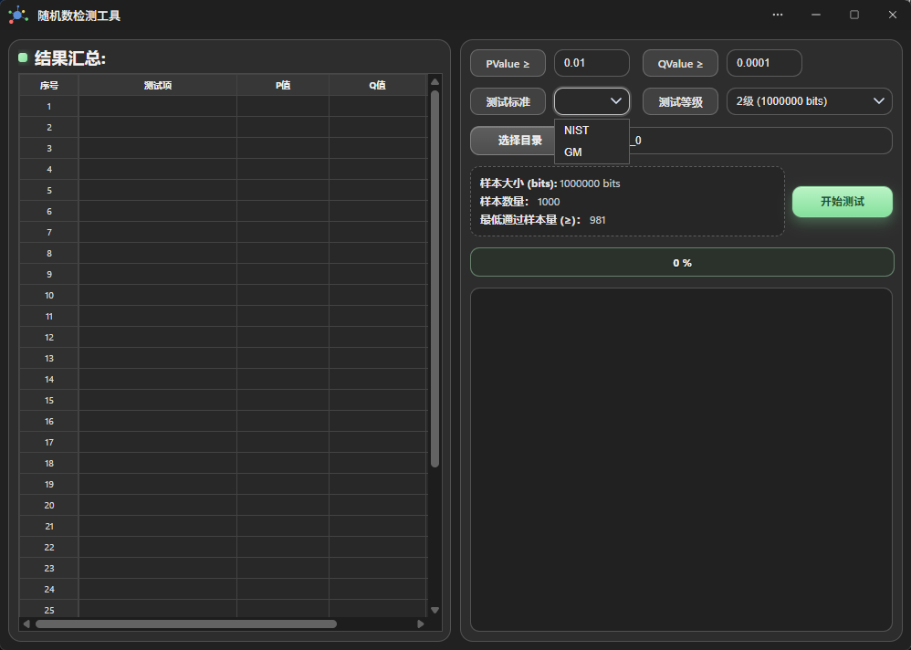
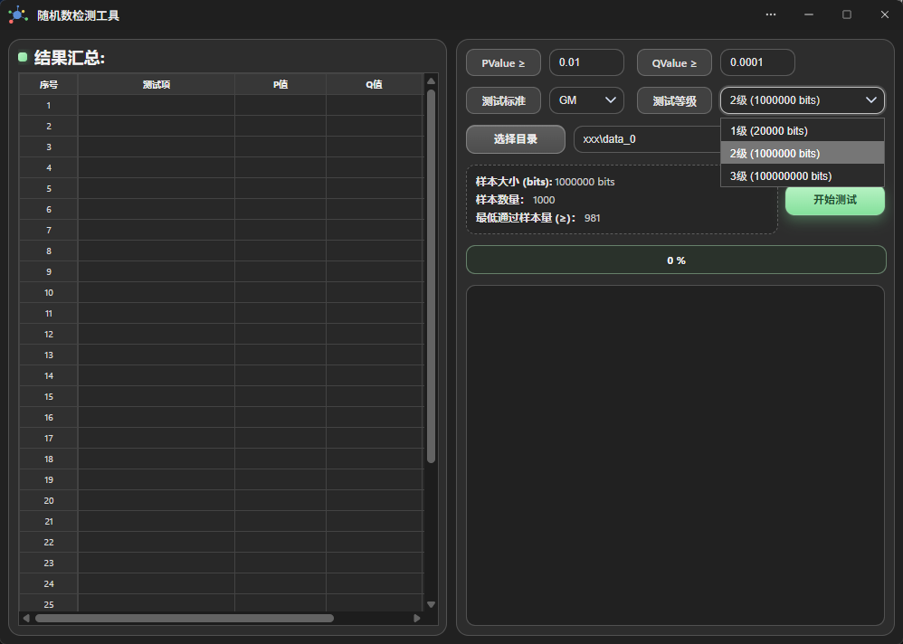

# 随机数检测工具用户使用说明书

文档版本：1.0　编制日期：2026-10-09　适用版本：[当前可用 exe 基线](00_文档索引.md)。

## 1. 程序用途

本程序读取本地二进制样本，执行“NIST”或“GM”套件，显示跨样本通过情况、运行日志和目录文件失败清单，并导出结果汇总 CSV。检测结果反映当前算法、参数和统计规则下的表现，不单独证明生成器的密码学安全性，也不是标准符合性认证报告。实际清单见 [测试项与参数附录](03_测试项与参数附录.md)。

## 2. 环境与启动

| 准备内容 | 说明 |
|---|---|
| Windows 64 位电脑 | 发布文件为 Windows amd64；本机已验证 Windows 11 |
| Microsoft Edge WebView2 Runtime | 页面渲染所需；安装 Edge 浏览器本身不能替代检查该运行库 |
| 可用 exe | 优先使用本次已修复的未压缩 `randomtest_stdtest_vue3_wailsv2.exe` |
| 输入数据 | 原始二进制文件或定长二进制样本目录 |
| 文件权限 | 能读取输入、写入 WebView2 用户数据目录及 CSV 保存目录 |

正式 exe 不需要 Go、Wails、Node.js 或 Web 服务。运行库已具备时，检测和 CSV 保存本身在本地完成；运行库安装或更新可能需要网络。运行库分发要求参考 [Microsoft 官方说明](https://learn.microsoft.com/en-us/microsoft-edge/webview2/concepts/distribution)。

双击仓库中的文件：

```text
randomtest_stdtest_vue3_wailsv2.exe
```

当前 exe 未数字签名，可能出现未知发布者类提示，应确认实际提示内容和文件来源。安全提示与后续 WebView2 初始化失败应分别排查。

INI 配置是可选的。无配置时仍可进入界面，但“测试标准”可能空白；请先手动选择 NIST 或 GM，再选择有效等级及真实输入目录。

## 3. 主界面


**图 1　主界面示例。**`xxx\data_0` 是占位路径，截图中的 1000 不表示实际输入已分析。

| 区域 | 操作与含义 |
|---|---|
| 左侧结果汇总 | 序号、测试项、P值、Q值、结果；数据产生后出现“点击保存” |
| 右侧 P/Q 阈值 | 设置单样本 P/Q 门限 |
| 测试标准、等级 | 选择套件及样本规模 |
| 选择目录、路径框 | 选择目录或手工输入路径；“清除”仅清空路径 |
| 样本信息 | 大小、分析数量及最低通过量 |
| 开始/停止测试 | 开始后再次点击按钮请求停止 |
| 进度条 | 样本处理百分比；任务结束后归零 |
| 运行日志 | 警告、错误、统计表、失败清单及完成消息 |
| 标题栏 | 更多菜单、最小化、最大化/还原、关闭；可拖动 |

表格可以水平和垂直滚动。截图宽度下“结果”列可能被遮挡，需向右拖动底部滚动条。空白占位行不是真实检测项。

## 4. 输入数据准备

### 4.1 标准与等级

| 选择 | 每样本 bits | 每样本 bytes |
|---|---:|---:|
| NIST + 2 级 | 1,000,000 | 125,000 |
| GM + 1 级 | 20,000 | 2,500 |
| GM + 2 级 | 1,000,000 | 125,000 |
| GM + 3 级 | 100,000,000 | 12,500,000 |

“级”是程序内的配置名称。NIST 下拉框虽能选 1/3 级，后端会拒绝；请始终使用 NIST + 2 级。GM 3 级包含大块数据与算法临时内存开销，耗时和内存占用可能明显增加。

输入必须是原始 bytes，每字节从高位到低位作为 8 bits。一个字节 `0xA5` 对应 `10100101`。程序不解码 `0101` 文本、十六进制文本或 CSV，也不自动去除文件头。扩展名不限，建议 `.bin`。

### 4.2 推荐：每个文件一个样本

以 2 级为例：

```text
C:\RandomTestData\samples\
├── sample_0001.bin   125000 bytes
├── sample_0002.bin   125000 bytes
└── sample_0003.bin   125000 bytes
```

目录模式只扫描第一层，不递归子目录，不按后缀过滤。每个文件大小必须恰好等于所选等级字节数；大小不符会警告并跳过。目录中的大文件不会自动分成多个样本。实际数量以合格文件扫描数为准。

检测过程中保持输入稳定，避免分析后改变文件。不要只依据默认显示的“1000”开始检测。

### 4.3 可选：连续样本大文件

后端支持把大文件从开头按定长块顺序读取。例如 2 级的 `125000000 bytes` 文件包含 1000 个完整样本。

界面无“选择文件”按钮，可手工输入完整文件路径，再改变一次有效等级或 P 阈值触发路径分析。NIST 可临时修改 P 阈值后恢复原值，最终保持 2 级。确认样本数更新后再运行。

分析数量为 `floor(文件大小/每样本字节数)`；尾部不足一块不包含在此数量中。分析失败时旧数量可能保留，必须核查。直接指定过多块数会产生读取不足错误，指定较少块数只处理文件前部。

## 5. 参数配置

### 5.1 阈值

| 参数 | 初始值 | 作用 |
|---|---:|---|
| PValue ≥ | 0.01 | 单样本 P 门限，并用于跨样本通过数区间 |
| QValue ≥ | 0.0001 | GM 单样本 Q 门限；NIST 报表不使用 Q |

输入有效数字且严格在 `(0,1)`。阈值不是样本数量，也不是结果表中的计数比。同一组对比检测宜使用一致阈值，并另行记录。

### 5.2 标准与等级选择



**图 2　标准选择。**NIST 对应 2 级；GM 对应 1/2/3 级。每项算法的固定参数不在 GUI 中单独编辑。



**图 3　GM 等级菜单。**按实际样本大小选择等级。

### 5.3 选择输入与核实数量

1. 点击“选择目录”，选中准备好的样本目录。
2. 确认路径为真实目录，日志没有路径分析错误。
3. 检查样本大小、数量及最低通过量，再开始检测。

目录模式推荐重新点击“选择目录”完成路径更改。手工改路径没有专门的即时分析动作，可重新选择目录或修改一次标准/等级/P 阈值触发分析。清除路径后，样本信息不一定同时归零。

## 6. 开始、进度与停止

### 6.1 操作流程

1. 选择有效标准/等级，设置并记录 P/Q 阈值。
2. 选择真实输入目录，核实合格样本数量大于 0。
3. 点击“开始测试”，查看日志与进度。
4. 等待按钮恢复为“开始测试”，检查“测试完成”消息及新的结果表。
5. 检查全部相关结果行，导出 CSV。

开始后表格清空、按钮变为“停止测试”，提交参数以开始时为准。运行时表单仍可编辑，但不会改变已提交的任务；运行期间及完成后保存前应保持参数不变。

进度按已处理样本数计算，不按检测项数计算。大样本算法耗时较长，短时间进度不变不一定表示卡死。成功完成后日志显示总测试时间与完成信息，结果保留，进度归零。因此 **0% 不等于未运行或失败**，应结合按钮、日志和表格判断。

### 6.2 停止

运行时点击“停止测试”发送协作式取消请求。它不会强制终止正在计算的算法；目录模式已排队任务仍可能继续处理，停止有一定延迟。

取消通常以“测试已停止”结束，前端可能以 `[ERROR]` 显示该消息。本次取消任务不生成部分结果表。退出或重新加载前，应等待任务结束并保存需要的结果。

## 7. 结果解释

### 7.1 五列含义

| 列 | 含义 |
|---|---|
| 序号 | 结果行序号，不是文件编号 |
| 测试项 | 算法名称及参数；`[0]` 等为多值子项索引 |
| P值 | P 门限通过样本数 / 本行统计样本数，如 `990/1000` |
| Q值 | GM 的 Q 门限通过计数比；NIST 为 `-` |
| 结果 | 当前版本仅依据本行 P 通过数区间 |

`990/1000` 表示 990 个样本满足该项 P 门限，不是某个样本的 P=0.99。原始概率没有在此表格中显示或导出。

### 7.2 下界与上界

程序同时检查跨样本通过数的上下界，界面只提示最低通过量。设 `n` 为有效样本数、`α` 为 P 阈值：

```text
min = ceil(((1-α) - 3×sqrt((1-α)×α/n)) × n)
max = floor(((1-α) + 3×sqrt((1-α)×α/n)) × n)
要求 min ≤ 通过数 ≤ max
```

`n=1000, α=0.01` 时，允许区间为 **981～999**。

| P 计数示例 | 当前结果 | 原因 |
|---|---|---|
| 980/1000 | 不通过 | 低于下界 |
| 990/1000 | 通过 | 位于区间 |
| 1000/1000 | 不通过 | 高于上界 |

这是当前代码实际行为，不能只按“≥981”理解。小样本试运行也套用公式，但不能替代正式样本规模的统计评估。

### 7.3 GM 的 P/Q 差异

GM 的“结果”文字只按 P 判定，Q 不满足时仍可能显示“通过”。日志统计表对 P、Q 独立用 `*` 标记，目录失败清单按单文件 P 或 Q 失败列出文件。因此应同时查看两列与日志，不能只读“结果”。

日志 Q 计数区间目前也使用 P 阈值 α 计算；Q 阈值控制单样本 Q 门限，不直接用于替换这个区间中的 α。

### 7.4 NIST 特殊子项

NIST 非重叠模板匹配、随机游程及变体展开为多行，实际行数可能远多于 17 个 Suite 入口。随机游程系列以各子项实际适用样本数为分母，可能不等于主界面数量。

`0/0` 表示本行没有可判定样本。GUI 当前显示“不通过”，不应据此单独断言输入不随机。

NIST 多值项的目录失败清单存在未逐子项判定的限制，可能列出全部文件，即使部分汇总子项通过。应优先分析展开的汇总行，不能把该清单当作可靠的逐子项结论。

## 8. 导出 CSV

1. 成功产生结果后，点击“结果汇总”右侧“点击保存”。
2. 在系统对话框中选择保存目录，不是输入文件名。
3. 检查日志“结果已保存到”及完整路径。
4. 使用 Excel 或支持 UTF-8 的工具打开文件。

默认名称示例：

```text
samples_测试标准NIST_测试等级2级 (1000000 bits).csv
```

CSV 带 UTF-8 BOM，包含五列表格，不包含完整日志、实际阈值、耗时、原始 P/Q、输入文件哈希。正式留档应另外记录日期、输入来源、标准、等级、阈值及数量。

计数比写为 Excel 文本公式，如 `="990/1000"`，Excel 显示 `990/1000`；机器读取 CSV 时会看到公式，应按此编码提取计数。

**同名文件会直接覆盖，没有额外确认。**重复检测建议使用不同目录或保存后重命名。导出前勿改变标准/等级：文件名来自点击保存时的界面值，数据来自上次成功检测，修改后可能造成标注不一致。

## 9. 更多菜单与日常操作

顶部“…”菜单提供：

| 菜单 | 行为 |
|---|---|
| 关于应用 | 查看介绍及界面版本 `v1.0.1` |
| 新建窗口 | 启动独立 exe 进程，任务独立但资源占用叠加 |
| 切换主题 | 深/浅色切换，选择保存到本地浏览器存储 |
| 重新加载 | 重载前端；当前日志和表格不自动恢复 |

关闭按钮退出当前实例，未保存结果可能丢失。标题栏“全屏”实际执行最大化，随后可还原。日志“清除”只清除显示，不停止任务，不删除表格或后端结果缓存。GUI 仅保留最近 2000 行，较早日志可能被截去。

## 10. 可选 INI 初始配置

文件名为 `randomtest_stdtest_vue3_wailsv2_config.ini`，程序从 **当前工作目录** 查找。可在明确工作目录中启动：

```powershell
Set-Location 'C:\RandomTestApp'
.\randomtest_stdtest_vue3_wailsv2.exe
```

该目录的 INI 示例：

```ini
[config]
IsFile = false
FilePath = "C:\RandomTestData\all_samples.bin"
TestNum = 1000
RootDirPath = "C:\RandomTestData\samples"
TestType = N
TestLevel = 2
workers = 4
```

`workers` 用小写，正整数指定协程数；0、缺省或读取失败时采用 CPU 核数。其他键按示例保持大小写。目录模式仍使用全部合格文件，`TestNum` 不把目录截断到 1000 个文件。

INI 仅初始化，界面修改不保存回文件。以上 INI 不设置 P/Q 阈值，初始阈值仍来自 core 默认值。

## 11. 检测记录

正式检测记录应包含输入来源与生成方式、路径、每样本 bytes、有效数量、标准/等级、P/Q 阈值、开始/结束时间、CSV 文件名及异常/停止情况。CSV 不会自动包含这些全部信息，应由检测流程补充。
